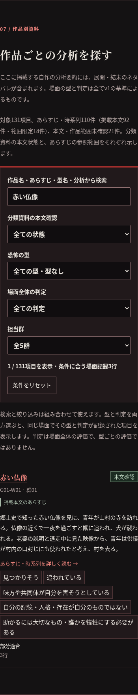
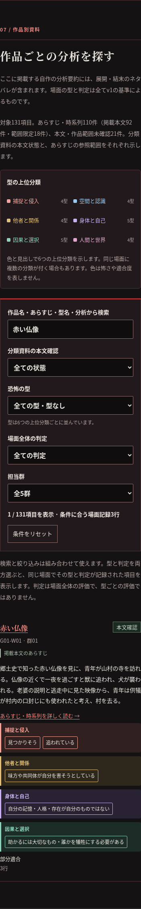

# 上位6分類を見分けるUIレビュー

基点はPR #23までのmain `e73678799497d312e171c2e3ec04ffc3ef0daafd`。同じ暗い枠で並んでいた26型を、既存v1の6分類ごとの見出しと色で整理しました。この変更は別ブランチ・ドラフトPRでレビューし、まだマージ・公開しません。

## 表示の対応

名称は公開データの `type_groups`、所属は既存26型の識別子に従います。日本語名称を主表示にし、ID・リンク・型と判定の絞り込み条件は保持します。

|上位分類|補助色|型数|
|---|---|---:|
|捕捉と侵入|珊瑚色|4|
|空間と認識|青|4|
|他者と関係|黄土色|4|
|身体と自己|紫|5|
|因果と選択|青緑|5|
|人間と世界|薄紅色|4|

- 一覧・場面詳細・場面間の変化・時系列の型を、日本語の見出しを付けた枠にまとめました。複数分類を同じ場面へ付けた記録も保持します。
- 一覧の凡例から分類の辞典へ移動できます。辞典、型タグ、型フィルタの選択中の分類名で同じ色を使います。色は怖さや適合度を示しません。
- 型の並びは分類の見出し順です。物語の段階、出来事の順序、場面内の恐怖・解釈は変更していません。
- 色なしでも見出しで分かる構成です。forced-colorsで名称とキーボードによる辞典移動を確認し、色覚の全色盲シミュレーション画像も保存しました。色覚差のある利用者による実地評価は未実施です。
- v3比較ビュー・v3定義・調査データへの変更は含みません。別セッションの追加調査と切り離したUI変更です。

## 手元で開くプレビュー

[プレビューZIP](scare-pattern-groups-review.zip)を解凍し、`preview.html` をブラウザで開いてください。[表示手順](preview-instructions.txt)を同梱しています。CSS・JavaScript・131件の公開データをHTMLに含み、追加の通信なしで検索・詳細・時系列・型辞典を確認できます。出典などの外部リンクはクリック時に開きます。

公開プレビュー環境はありません。ZIPは現行v1側のUIのプレビューで、別ページのv3比較ビューは含みません。

## PC・スマホの比較

PCは1280px、スマホは390px。同じ基点main・作品・条件で撮影しました。一覧は「赤い仏像」の検索結果です。

|画面|変更前|変更後|
|---|---|---|
|一覧・PC|[変更前](catalogue-before-desktop.png)|[凡例と分類別の型](catalogue-after-desktop.png)|
|一覧・スマホ|[変更前](catalogue-before-mobile.png)|[凡例と分類別の型](catalogue-after-mobile.png)|
|辞典・PC|[変更前](dictionary-before-desktop.png)|[共通色の分類見出し](dictionary-after-desktop.png)|
|辞典・スマホ|[変更前](dictionary-before-mobile.png)|[共通色の分類見出し](dictionary-after-mobile.png)|
|時系列・PC|[変更前](timeline-before-desktop.png)|[出来事・恐怖と上位分類](timeline-after-desktop.png)|
|時系列・スマホ|[変更前](timeline-before-mobile.png)|[縦の流れと上位分類](timeline-after-mobile.png)|
|場面記録|—|[PC](scene-after-desktop.png)・[スマホ](scene-after-mobile.png)|
|選択中の型と上位分類|—|[PC](filter-after-desktop.png)・[スマホ](filter-after-mobile.png)|
|色覚シミュレーション|—|[全色盲・スマホ](catalogue-monochrome-after-mobile.png)|




## 検証と保全

- Python 37件、Node 13件、Playwright/Chromium 21件が成功。リポジトリ完全性、ビルド、JS構文、diffを確認。
- 全131作品を320pxで巡回し、あらすじ110件・未確認21件・時系列452段階と全参照リンクを確認。全作品一覧の型の集合と所属分類を元データと照合しました。
- PC/768px/390px/320px、旧型IDのURL、型と判定の同一場面での絞り込み、履歴、凡例から辞典への移動、キーボード、検索リセット、型なし、長い名称、縦の軸を確認。
- 実際の表示色と背景色から、凡例・分類見出し・型リンクの通常文字コントラスト4.5:1以上を検査。確認範囲の最小値7.72:1。forced-colorsでも名称・リンクが利用できます。
- 変更前6画面・変更後11画面にJSエラー・横方向のはみ出しなし。モノクロ画像はChromiumのachromatopsiaシミュレーションです。
- `docs/data.json` と `site/narratives.json` は基点mainとバイト単位で一致。131項目、258場面、166出典、26型、追補39件を保持しました。
- `docs/v3/` のデータ・比較ページ・v3の調査資料は変更なし。独立v3ビルドの `--check` が成功。TeXプロジェクトは変更していません。

```sh
python3 scripts/validate_repository.py --complete
python3 -m unittest discover -s tests
python3 scripts/build_site.py
node --test tests/site.test.mjs
node --test tests/site.browser.test.mjs
python3 scripts/build_v3_site.py --check
python3 scripts/build_site_preview.py site/review/classification-groups/scare-pattern-groups-review.zip --instructions site/review/classification-groups/preview-instructions.txt
```

Playwrightが通常の検索パスにない場合の設定は[サイトの開発手順](../../README.md)を参照してください。
